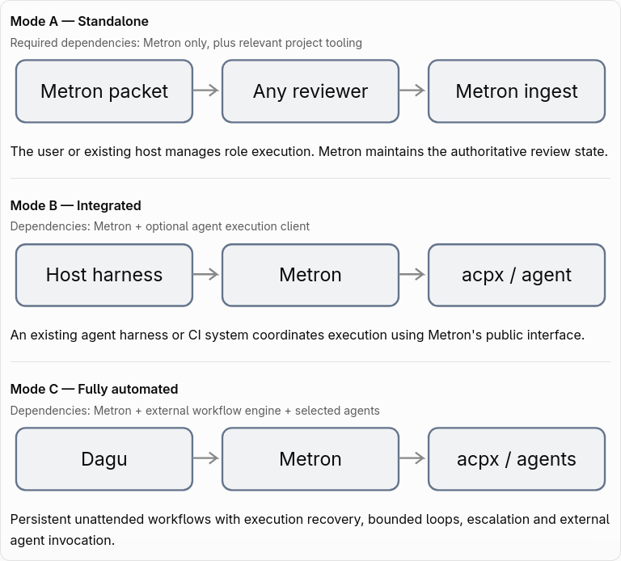
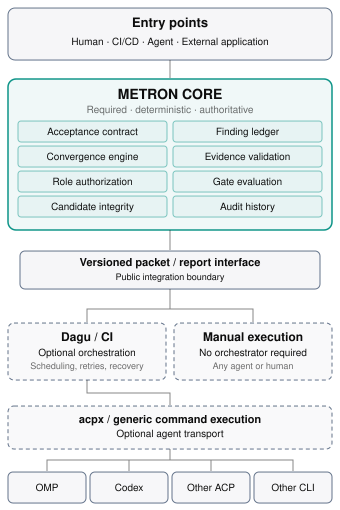

<h1 align="center">
  M E T R O N
  <br>
  <sub>Convergent Engineering Review Framework</sub>
</h1>

<p align="center"><em>Quality without excess. Progress without compromise.</em></p>

Metron decides whether a specific commit of your repository is approved for a
specific lifecycle stage, and it bounds how long the review process that gets
you there can run without a decision of yours: a campaign ends approved or
suspended, never by wearing the reviewers down.

It is a single deterministic executable. It does not run models. Humans and
agents supply the engineering judgment; Metron supplies the rules they cannot
bend: what must be reviewed, what may block, what a correction may change,
when a finding may be reopened, when repeated failure must change the
investigation, when the process must stop and wait for you, and when the gate
is open.

> **Status: early.** The standalone core works end to end in local trust mode.
> There are no releases yet, agent execution is not integrated, and the gate
> must not be relied on against untrusted agents. See
> [What is not here yet](#what-is-not-here-yet).

## Why

Agent-driven review loops tend to fail in one of two ways. Either the bar is
whatever the last reviewer felt like, or the bar is "no further improvement is
possible", which no codebase ever meets. Metron separates the two questions:

- *Is this candidate sufficiently correct, reliable, efficient, maintainable
  and safe for what it is about to be used for?* That is the gate.
- *Could it be better?* That is a backlog.

## How it works

You write one file, the **acceptance contract**: what the project is for, the
stage you want to enter, what entering it authorizes, and the requirements
that must hold. Everything else is fixed by the protocol.

Metron then runs a loop in which it always names exactly one next step:

![The Metron review loop. A pinned contract and its mandatory checks lead to an independent review. RED starts a correction on one candidate: fix, run the checks, verify; a failed check, a rejected fix or a blocking regression goes back to the fix, and once every fix is confirmed the new candidate is reviewed. INDETERMINATE goes to governance. GREEN goes to the deterministic gate and the next authorized stage. Non-blocking findings go to the improvement backlog, outside the correction. Convergence safeguards bring in an auditor, and a suspension stops the campaign until governance resumes it.](docs/assets/review-loop.svg)

The contract's automated checks run first, so a review never starts on a
candidate that fails them. Then:

1. A **reviewer** examines the candidate commit, read-only, across 18 review
   domains, and reports findings in five tiers. Only `T0` and `T1` block, and
   only when tied to a requirement or an unacceptable risk in the contract.
2. An **implementer** fixes the blocking findings as a batch, or disputes one.
   A correction changes what those findings need and nothing else: every
   commit since the review is listed under a fix.
3. The checks run again on the fixed candidate.
4. A **verifier** confirms or rejects each fix, and rejects one that changes
   more than its finding needs.
5. The reviewer reviews the new candidate. When nothing blocks and every
   requirement is satisfied with evidence, the verdict is GREEN. When nothing
   blocks but a requirement could not be verified, it is INDETERMINATE, and
   governance supplies the missing evidence or amends the contract.
6. If the loop stops converging (three failed steps without GREEN, the same
   file changed by fixes in three rounds, a disputed finding), an **auditor** is
   brought in, and a finding whose fix keeps failing needs a root-cause
   analysis before it can be fixed again. The bar never drops.
7. If that does not help, the campaign is **suspended**: after a process
   audit, when an auditor asks for it, or after 20 packets without an
   approval (the contract can change these limits). Only you, as governance,
   can resume it. Nothing ever opens the gate because a count, a budget or a
   time limit ran out.

Non-blocking findings go to the backlog. They are worked on in ordinary
commits, never inside a correction, and a later review closes the ones it
finds addressed.

Each role receives a **packet** and answers with a structured **report**.
Metron validates every report, records everything in a hash-chained ledger,
and evaluates the gate:

```
G = C ∧ B ∧ E ∧ I ∧ V
```

| | The gate is open only when |
| --- | --- |
| C | every applicable requirement is satisfied in the latest review |
| B | no blocking finding is unresolved, none was recorded on this candidate and fixed on another, and no escalation is open |
| E | every automated check passed on this exact candidate |
| I | the candidate, the contract and the ledger are the ones that were reviewed |
| V | an independent reviewer issued GREEN for this candidate |

### Who runs the roles

Metron names each step and checks its result, but it never carries a step
out. Something else has to hand the packet to a person or an agent and bring
the report back. There are three ways to arrange that, and they differ only
in how much of that hand-off is automated: all three go through the same
commands, so the rules and the gate are identical in each.



Mode A is what works today. Modes B and C rely on tools that Metron does not
include and never requires: an agent client such as acpx, which starts an
agent and passes it a prompt, and a workflow engine such as Dagu. Both
integrations are planned as optional add-ons; the
[decision records](docs/decisions/) say why and how far they have got.

In every mode, whatever drives the loop runs the step `metron next` names and
stops in two cases: the step is `none`, because the gate is open, or its owner
is `governance`. A governance step is a decision for the repository's owner,
never something to automate, and a campaign waiting for one has not been
approved.

## Quickstart

The [quick-start guide](docs/quickstart.md) walks a small repository through
a complete loop, with the real output of every command. The
[cheat sheet](docs/cheatsheet.md) has the commands, the steps and the report
fields on one page. The short version follows.

Build the binary (Go and [`just`](https://just.systems) required):

```
git clone https://github.com/patacca/metron && cd metron
just build            # produces bin/metron
```

In the repository you want to review:

```
metron init                               # creates .metron/ with a commented contract
$EDITOR .metron/contract.yaml             # every empty value is a decision to make
metron contract                           # lists what is missing or wrong
metron contract pin -m "initial contract" # authorizes it
```

From here on, ask Metron what to do and do it:

```
metron next                               # the single next step, and the command for it
metron check                              # runs the contract's check commands on HEAD
metron packet --format prompt             # the brief for whoever acts next, human or agent
metron packet --format skeleton -o .metron/work/report.json
metron ingest .metron/work/report.json    # validates the report and records the outcome
metron gate                               # exits 0 only when the gate is open
```

`metron packet` hands out the work; `metron ingest` takes the answer. The
prompt format is self-contained: paste it into any agent, or read it yourself.
The skeleton is a report with the right shape and the judgments left empty.

Write reports under `.metron/work/`, or outside the repository. A review is
bound to a clean working tree, and a stray `report.json` next to the code
would make it unclean.

`metron status`, `metron findings` and `metron log` show where things stand.
Commands meant for automation accept `--json`. Exit status is 0 for success
or an open gate, 1 for a negative outcome, 2 for a usage error and 3 for an
environment error. A closed gate does not mean there is more to do: only
`metron next` says that.

Commit `.metron/` together with your work. The candidate under review is
identified by its tree without `.metron/`, so committing review state never
invalidates a review, and any other change always does.

## What it does not guarantee

Metron currently implements **local trust mode**, for a developer and the
agents they run. In that mode the ledger detects accidental corruption and
partial edits, but an actor who can write it can rewrite it; role identities
are declared, not proven; and whoever runs `metron gate` controls the binary.
Do not use it as a deployment gate against agents you do not trust.
[The trust model](docs/trust-model.md) says exactly what holds and what the
planned authenticated mode adds.

A GREEN gate approves one candidate for one stage and the activity the
contract names. It does not claim the code is free of defects or optimal.

Metron bounds how long a campaign runs before the next step is yours; it
cannot make the campaign end GREEN. That takes a candidate that can meet the
contract, a contract that can be met, and roles that judge well. A suspended
campaign is the process stopping where only your decision can help.
[Section 10 of the architecture](docs/architecture.md#10-convergence-safeguards)
states what is guaranteed and what is not.

## What is not here yet

- Running agents. Metron hands out packets and takes reports; you, your
  harness or your orchestrator run the roles. Integration through the Agent
  Client Protocol and workflow templates are planned, as optional add-ons.
- Authenticated enforcement mode.
- Releases and prebuilt binaries.

## Documentation

- [Quick start](docs/quickstart.md): one complete loop, step by step.
- [Cheat sheet](docs/cheatsheet.md): commands, steps, report fields and exit
  codes on one page.
- [Architecture](docs/architecture.md): the normative design.
- [Trust model](docs/trust-model.md): what Metron does and does not guarantee.
- [Decisions](docs/decisions/): why it is built the way it is.
- `metron protocol` prints the review protocol that every role works under,
  and `metron schema` the JSON Schemas of contracts, packets, reports and
  ledger events.



## Development

Requires Go (see `go.mod`), `git` and `just`.

```
just check    # gofmt, vet, tests
just build    # bin/metron
just fuzz     # run every fuzz target briefly
just cross    # CGO-free binaries for Linux, macOS and Windows
```

[AGENTS.md](AGENTS.md) holds the rules for working on the code.

## License

Apache-2.0. See [LICENSE](LICENSE).
