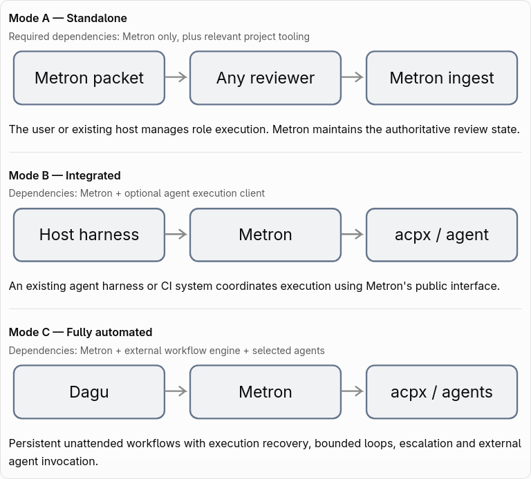

# 0001: Standalone deterministic core, delegated execution

Status: accepted, 2026-11-25

## Decision

Metron is an independent, model-agnostic, harness-agnostic and
orchestrator-agnostic CLI. It stays fully functional with no agent harness and
no workflow engine installed.

Metron owns the review protocol, acceptance contracts, the finding ledger and
its state machine, convergence detection, evidence validation, candidate
integrity, role authorization and provenance, gate evaluation, audit history,
and the versioned packet and report formats.

Metron does not run agents and does not orchestrate workflows. Those are
delegated to existing tools through three integration mechanisms, in order of
preference:

1. Agent Client Protocol (ACP), through an external headless ACP client.
2. A generic command interface for harnesses without ACP.
3. Manual packet export and report ingestion, for any agent or human.

Three execution modes follow from this, and all three enforce the same
semantics because all three go through the same commands:

Metron determines the next permitted action. Orchestrators execute it. Agents
provide engineering judgment. Neither agents nor orchestrators can override the
contract, ledger state, convergence policy or gate outcome.

## Consequences

- The gate fails closed. Exhausted iteration limits, timeouts, execution
  failures, malformed reports, missing evidence and unavailable agents never
  produce approval.
- Metron will not grow a custom agent harness, workflow engine, provider
  abstraction, process supervisor or fleet manager unless existing tools are
  shown to be inadequate.
- Implementation order: the standalone core; the public packet, report and
  execution interfaces; qualification of one reference harness through ACP;
  one more ACP harness and one non-ACP integration; optional workflow
  templates; an integration conformance suite.
